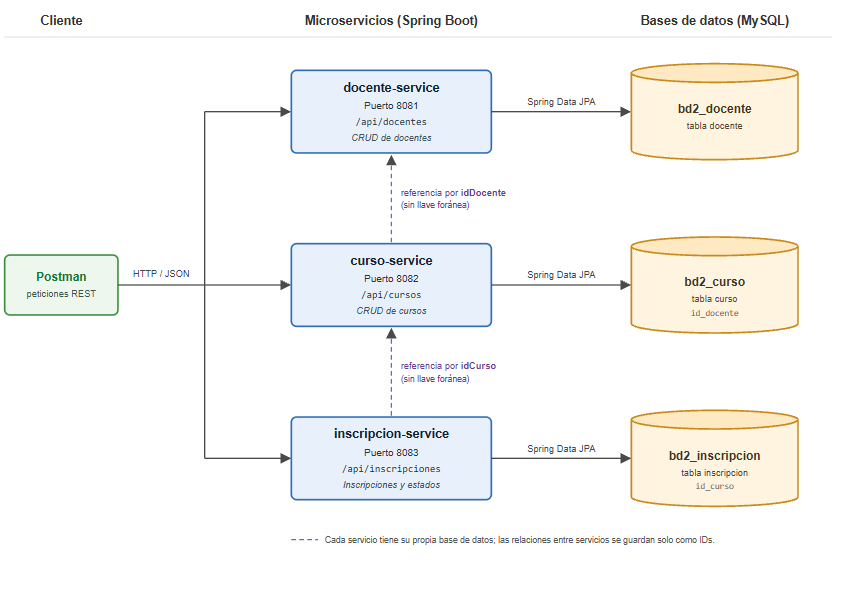

# Sistema de Gestión de Cursos — Microservicios con Spring Boot

**Evaluación N° 03** 

**Estudiante:** Faustino Quispe Alexander Oliver

Una academia necesita organizar a sus docentes, sus cursos y las inscripciones de los participantes. El sistema se divide en tres microservicios independientes. Cada uno tiene su propio proyecto, su propio puerto y su propia base de datos.

## Arquitectura




| Microservicio | Puerto (dev) | Base de datos (dev) | Responsabilidad |
|---|---|---|---|
| docente-service | 8081 | `bd2_docente_dev` | Registrar y administrar docentes |
| curso-service | 8082 | `bd2_curso_dev` | Registrar cursos y asignarlos a un docente |
| inscripcion-service | 8083 | `bd2_inscripcion_dev` | Inscribir participantes en cursos y gestionar su estado |

Los servicios no comparten tablas. Las referencias entre ellos se guardan solo como identificadores:

- `Curso.idDocente` → docente de docente-service
- `Inscripcion.idCurso` → curso de curso-service

Como cada servicio tiene su propia base, no existen llaves foráneas entre servicios.

## Requisitos

- Java 21
- Maven (incluido con el wrapper `mvnw`)
- MySQL 5.5 o superior (XAMPP)
- IntelliJ IDEA
- Postman

## Tecnologías

- Spring Boot 4.1.2
- Spring Web MVC, Spring Data JPA (Hibernate), Bean Validation
- MySQL Connector/J, Spring Boot DevTools

## Estructura del proyecto

```
gestion-cursos/
├── docente-service/
├── curso-service/
├── inscripcion-service/
└── docs/
    ├── bd2_gestion_cursos.sql
    ├── diagrama-arquitectura.png
    └── gestion-cursos.postman_collection.json
```

Cada microservicio sigue la misma organización:

```
src/main/java/com/tecsup/
├── controller/    Endpoints REST
├── dto/           Datos de entrada con validaciones
├── exception/     Excepciones propias y GlobalExceptionHandler
├── model/         Entidades JPA
├── repository/    Acceso a datos (JpaRepository)
├── services/      Lógica de negocio
└── ...ServiceApplication.java
```

## Bases de datos

El script completo está en `docs/bd2_gestion_cursos.sql`.

```sql
CREATE DATABASE IF NOT EXISTS bd2_docente;
CREATE DATABASE IF NOT EXISTS bd2_curso;
CREATE DATABASE IF NOT EXISTS bd2_inscripcion;

CREATE DATABASE IF NOT EXISTS bd2_docente_dev;
CREATE DATABASE IF NOT EXISTS bd2_curso_dev;
CREATE DATABASE IF NOT EXISTS bd2_inscripcion_dev;
```

En el perfil `dev`, Hibernate crea las tablas automáticamente (`ddl-auto: update`).

## Configuración y perfiles

Cada servicio tiene tres archivos en `src/main/resources`:

| Archivo | Contenido |
|---|---|
| `application.yaml` | Nombre del servicio y perfil activo |
| `application-dev.yaml` | Configuración de desarrollo |
| `application-prod.yaml` | Configuración de producción |

El perfil se elige en `application.yaml`:

```yaml
spring:
  profiles:
    active: dev
```

### Valores que cambian entre ambientes

| Propiedad | dev | prod | Motivo |
|---|---|---|---|
| Puerto | 8081 / 8082 / 8083 | 9081 / 9082 / 9083 | Separar los ambientes |
| Base de datos | `bd2_..._dev` en `localhost` | `bd2_...` en el servidor | Las pruebas no afectan los datos reales |
| Usuario y contraseña | `root`, sin contraseña | Variables `DB_USERNAME` y `DB_PASSWORD` | No guardar credenciales reales en el código |
| `ddl-auto` | `update` | `validate` | En producción Hibernate no modifica las tablas |
| `show-sql` | `true` | `false` | El SQL en consola solo es útil al desarrollar |
| `include-stacktrace` | Por defecto | `never` | No exponer detalles internos en los errores |

En producción, la URL puede definirse con la variable `DB_URL`.

## Ejecución

1. Iniciar MySQL y ejecutar `docs/bd2_gestion_cursos.sql`.
2. Abrir la carpeta `gestion-cursos` en IntelliJ IDEA y cargar los tres `pom.xml` como proyectos Maven.
3. Ejecutar `DocenteServiceApplication`, `CursoServiceApplication` e `InscripcionServiceApplication`.
4. Verificar en cada consola el mensaje `The following 1 profile is active: "dev"` y el puerto asignado.
5. Probar los endpoints con Postman (importar `docs/gestion-cursos.postman_collection.json`).

Desde la terminal también puede ejecutarse cada servicio con:

```bash
./mvnw spring-boot:run
```

## Endpoints

### docente-service — `http://localhost:8081/api/docentes`

| Método | Ruta | Descripción |
|---|---|---|
| GET | `/api/docentes` | Listar docentes |
| GET | `/api/docentes/{id}` | Buscar docente por ID |
| POST | `/api/docentes` | Registrar docente |
| PUT | `/api/docentes/{id}` | Actualizar docente |
| DELETE | `/api/docentes/{id}` | Eliminar docente |

### curso-service — `http://localhost:8082/api/cursos`

| Método | Ruta | Descripción |
|---|---|---|
| GET | `/api/cursos` | Listar cursos |
| GET | `/api/cursos/{id}` | Buscar curso por ID |
| GET | `/api/cursos/docente/{idDocente}` | Listar cursos de un docente |
| POST | `/api/cursos` | Registrar curso |
| PUT | `/api/cursos/{id}` | Actualizar curso |
| DELETE | `/api/cursos/{id}` | Eliminar curso |

### inscripcion-service — `http://localhost:8083/api/inscripciones`

| Método | Ruta | Descripción |
|---|---|---|
| GET | `/api/inscripciones` | Listar inscripciones |
| GET | `/api/inscripciones/{id}` | Buscar inscripción por ID |
| GET | `/api/inscripciones/curso/{idCurso}` | Listar inscripciones de un curso |
| POST | `/api/inscripciones` | Registrar inscripción |
| PUT | `/api/inscripciones/{id}` | Actualizar inscripción |
| PATCH | `/api/inscripciones/{id}/estado` | Cambiar solo el estado |
| DELETE | `/api/inscripciones/{id}` | Eliminar inscripción |

## Ejemplos de solicitudes

**Docente**

```json
{
  "nombres": "Ricardo",
  "apellidos": "Mendoza Rojas",
  "dni": "45781236",
  "correo": "rmendoza@academia.pe",
  "especialidad": "Desarrollo Web",
  "estado": "ACTIVO"
}
```

**Curso**

```json
{
  "nombre": "Spring Boot desde cero",
  "duracion": 40,
  "precio": 450.00,
  "idDocente": 1,
  "estado": "ACTIVO"
}
```

**Inscripción**

```json
{
  "idCurso": 1,
  "nombres": "Carlos",
  "apellidos": "Quispe Mamani",
  "dni": "74125896",
  "correo": "carlos.quispe@gmail.com",
  "fecha": "2026-11-03",
  "estado": "PENDIENTE"
}
```

**Cambio de estado**

```json
{ "estado": "CONFIRMADA" }
```

## Validaciones y reglas de negocio

| Servicio | Regla |
|---|---|
| Todos | Ningún campo obligatorio puede ir vacío |
| docente | DNI de 8 dígitos y único; correo con formato válido; estado `ACTIVO` o `INACTIVO` |
| curso | Duración y precio mayores a 0; precio con máximo 2 decimales; `idDocente` obligatorio |
| inscripción | DNI de 8 dígitos; correo válido; fecha que no sea futura; estado `PENDIENTE`, `CONFIRMADA` o `CANCELADA` |
| inscripción | Un participante no puede inscribirse dos veces en el mismo curso |

## Manejo de errores

Todos los errores tienen el mismo formato JSON, gestionado por el `GlobalExceptionHandler`:

| Código | Situación | Ejemplo de respuesta |
|---|---|---|
| 400 | Datos inválidos | `{"codigo": 400, "mensaje": "Datos inválidos", "errores": {"precio": "El precio debe ser mayor a 0"}}` |
| 400 | JSON mal formado | `{"codigo": 400, "mensaje": "El cuerpo de la petición no es válido"}` |
| 404 | ID inexistente | `{"codigo": 404, "mensaje": "Curso no encontrado con id: 99"}` |
| 409 | Registro duplicado | `{"codigo": 409, "mensaje": "Ya existe un docente con DNI: 45781236"}` |

## Prueba de aceptación

1. Registrar un docente en `POST /api/docentes` → 201, `id: 1`
2. Registrar un curso con `idDocente: 1` en `POST /api/cursos` → 201, `id: 1`
3. Inscribir un participante con `idCurso: 1` en `POST /api/inscripciones` → 201
4. Consultar `GET /api/cursos/docente/1` y `GET /api/inscripciones/curso/1`
5. Enviar datos inválidos, un ID inexistente y un registro duplicado → 400, 404 y 409
